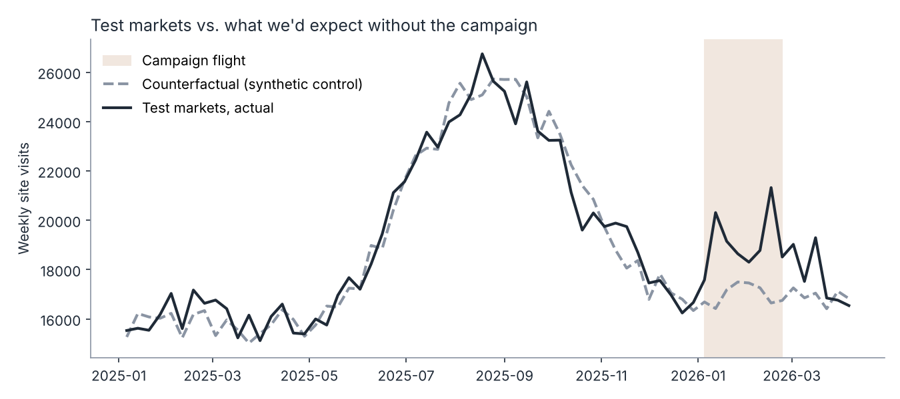
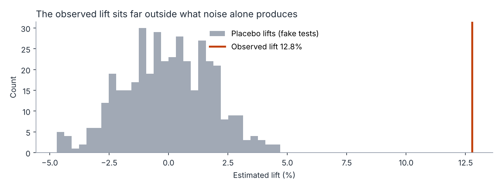
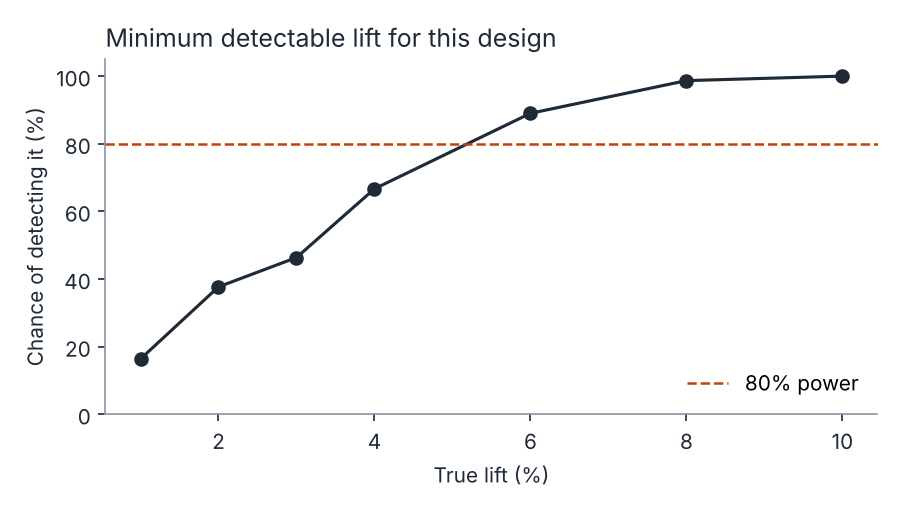

# Geo Lift: Measuring Offline Marketing Without Click Data

How do you prove a radio, billboard or podcast campaign worked when nobody clicks on a billboard?

This project shows the approach I use: run the campaign in a set of **test markets**, hold back comparable **control markets**, and estimate what the test markets would have done without the campaign. The gap between what happened and that counterfactual is the incremental effect.

> **Data note:** everything here runs on a **synthetic** dataset generated by `src/simulate.py`. The method mirrors geo test/control work I've designed for brand channels (radio, OOH and PR) in a previous role, but no real company data is used or shown.



## The question a marketing leader actually asks

*"We spent money on radio in five markets for eight weeks. Did it work, how much did it add, and should we spend more?"*

A good answer has four parts:

1. **How big was the effect?** Lift and incremental volume.
2. **How sure are we?** Could noise alone have produced this?
3. **Did it last?** Carryover after the flight ends.
4. **Would we even have seen a smaller effect?** Test design and power, ideally checked *before* spending.

## Approach

| Step | What it does | Why it matters |
|---|---|---|
| **Scaled control (difference-in-differences)** | Uses the test/control ratio from the pre-period to project the test markets forward | Simple, transparent, easy to explain to executives |
| **Synthetic control** | Builds a weighted blend of control markets that tracks the test markets before the flight | More robust when no single control market is a good match |
| **Placebo tests** | Re-runs the analysis 400 times on fake "test" groups drawn only from control markets | Shows how big a lift noise alone produces, giving an honest p-value |
| **Carryover window** | Measures lift in the 6 weeks after the campaign ends | Brand effects often outlast the flight; ignoring them undervalues the channel |
| **Power analysis** | Injects known lifts into fake tests to see how often each size would be detected | Tells you the smallest effect this design can reliably find, before money is spent |

## Results on the synthetic data

| Method | Lift | Incremental visits | Pre-period fit error (MAPE) |
|---|---:|---:|---:|
| Scaled control (DiD) | 12.8% | 17,276 | 3.7% |
| Synthetic control | 12.3% | 16,690 | 3.1% |

- The simulated "true" lift was ~12% after a two-week ramp, so both methods recover it well.
- **Placebo test:** the 95th percentile of lifts from 400 fake tests was 2.9%. The observed 12.8% sits far outside that range (p < 0.01).
- **Carryover:** a further 4.1% lift (about 4,100 extra visits) in the six weeks after the flight.



### What the power curve says

With five test markets and an eight-week flight, this design detects a **6% lift about 9 times in 10**, but a **2% lift only about 4 times in 10**. If the business expects a small effect, the honest recommendation is a longer flight or more test markets, not a test that is likely to come back inconclusive.



## How I'd take this further in production

- **Market selection:** choose test and control markets by matching pre-period trends, not just size or region.
- **Calibrate the media mix model:** use geo-test lifts as priors or calibration points for MMM, so the model's channel estimates agree with experimental evidence.
- **Connect to the funnel:** measure lift on downstream outcomes (sign-ups, paid conversions), not just visits, and report cost per incremental outcome.
- **Report uncertainty plainly:** give a range, not just a point estimate, and say what the test can and can't tell us.

## Run it

```bash
pip install -r requirements.txt
python run_analysis.py
```

This regenerates `data/geo_panel.csv`, prints a readout and writes the charts to `charts/`.

## Project structure

```
├── run_analysis.py      # end-to-end analysis, readout and charts
├── src/
│   ├── simulate.py      # synthetic weekly panel: 20 markets, seasonality, noise, campaign + carryover
│   └── geolift.py       # scaled control, synthetic control, placebo tests, power analysis
├── data/geo_panel.csv   # generated data
└── charts/              # generated charts and readout.txt
```

## About me

I'm Prajakta Talathi, a Toronto-based marketing measurement and growth analytics leader with 16+ years across FinTech, global consulting and banking technology. I build the measurement and planning that turn marketing spend into decisions leadership can defend.

[LinkedIn](https://www.linkedin.com/in/prajaktatalathi/) · [Tableau Public](https://public.tableau.com/profile/prajakta.talathi)
